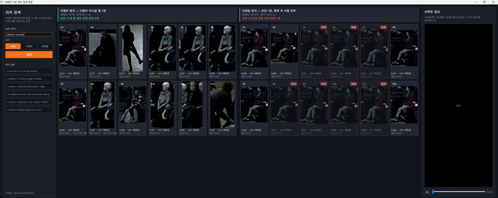

# event-semantic-indexer

**카메라 메타데이터가 알려주는 "사람이 지나간 순간"에만 임베딩하는 자연어 영상 검색 인덱서 (C++)**

자연어 영상 검색(예: "흰 비닐봉지를 든 사람")은 보통 일정 간격으로 프레임을 뽑아 화면 속 사람을 전부 임베딩합니다. 그러면 비용이 **채널 수 × 시간**에 비례하고, 오래 머문 한 사람이 인덱스를 도배합니다.

이 프로젝트는 AI 카메라가 보내는 객체 메타데이터(ONVIF / WiseAI 형식)를 트리거로 씁니다. 사람이 화면을 떠날 때 오는 **요약 프레임의 베스트샷 1장**만 임베딩해서, 비용을 **지나간 사람 수**에 비례하게 바꿉니다. 붐비는 현장에서 추적 ID가 끊겨 한 사람이 여러 조각으로 나뉘는 문제는 **트랙 조각 잇기**로 풉니다. 질문에서 장소·시각은 **온톨로지**로 먼저 거르고, 애매한 후보만 **VLM**에 다시 묻습니다. 실시간 모드에서는 사람이 확정될 때마다 인덱스에 바로 추가합니다. 그 위에 관제 요원이 말로 사람을 찾고 그 카메라를 바로 다루는 **챗봇**(`chat_server`)을 붙였습니다. 확실한 명령은 규칙이 처리하고, 애매한 말투만 로컬 LLM에 묻습니다.


*"elderly woman" 검색 — 왼쪽(이벤트 방식, 임베딩 197개)은 4위부터 흰머리 노인을 찾고, 오른쪽(프레임 방식, 5,879개)은 오래 앉아 있던 한 사람이 상위 12개를 전부 차지한다.*

**한눈에**
- 임베딩 **15분의 1** — 실제 카메라 24클립(장소 4종) 41,700번 → 2,860번. 오래 머무는 곳일수록 차이가 크다.
- 같은 CPU로 **96채널 vs 4채널** (실측 부하 재생)
- 상위 10개 안 정답 비율 0.50 → **0.70**, 애매할 때만 VLM에 다시 물으면 1위 0.33 → **0.63** (VLM 호출 39% 감소)
- 장소·시각을 먼저 걸러 상위 10개 중 장소가 틀린 결과 6.4개 → **0개**
- 실시간: 사람이 나가고 **약 3.9초 뒤 검색** (카메라가 퇴장을 알린 뒤로는 0.14초)
- 챗봇: 명령 문장 46개 중 **45개**(로컬 4B) / **46개**(9B)를 맞게 처리하면서 LLM은 **7번**만 불렀다. 위험 명령 6/6 거절, 가짜 카메라에 보낸 제어 14건 모두 맞는 카메라·동작

## 임베딩 횟수 — 실제 카메라 24클립, 장소 4종

MEVA 2018-03-07의 09:55·10:00·10:55 클립(클립당 5분)을 대역 카메라로 처리하고, 같은 메타데이터로 두 인덱스를 만들었다. 프레임 방식은 초당 1번 화면 속 사람을 전부, 이벤트 방식은 사람 1명(잇기 후 그룹)당 1번. (`eval/site_cost.py`)

| 장소 | 클립 | 빈 클립 | 프레임 (초당 1번) | **이벤트** | 비율 |
|---|---|---|---|---|---|
| 학교 | 6 | 2 | 39,008 | **2,639** | 1/15 |
| 버스 정류장 | 8 | 4 | 684 | **88** | 1/8 |
| 병원 | 7 | 5 | 1,957 | **119** | 1/16 |
| 사무동 | 3 | 0 | 51 | **14** | 1/4 |
| **전체** | **24** | | **41,700** | **2,860** | **1/15** |

차이는 사람이 화면에 머문 시간에 비례한다. 오래 머무는 곳(병원·학교)은 1/15~1/16, 지나가기만 하는 곳(사무동)은 1/4. 두 방식 모두 화면 속 사람만 임베딩하므로 빈 화면은 둘 다 0번이다.

## 정확도 — 질문 30개 (사람이 있는 현장 체육관·실외 2곳, 5분, 직접 라벨링)

| 방식 | 임베딩 | recall@1 | recall@5 | recall@10 | recall@50 |
|---|---|---|---|---|---|
| 프레임 (초당 1번, 화면 속 사람 전부) | 5,879 | 0.30 | 0.47 | 0.50 | 0.67 |
| 이벤트 (요약 프레임 베스트샷) | 253 | 0.33 | 0.50 | 0.57 | 0.90 |
| **이벤트 + 트랙 조각 잇기** | **197** | **0.33** | **0.57** | **0.70** | **0.90** |

recall@k = 상위 k개 결과 안에 정답 인물이 한 명이라도 있는 질문의 비율. 프레임 방식은 같은 사람이 상위 결과를 반복해서 차지해 @10에서 크게 뒤진다.

## 같은 CPU로 감당하는 채널 — 24클립 부하 재생

채널 i에 클립 (i mod 24)의 실측 임베딩 발생 시각을 배정해(빈 카메라 포함, 채널마다 랜덤 시작점) 실시간으로 재생하고, 실제 베스트샷을 CPU 8워커로 임베딩한다. 같은 PC에서 관제 영상 30fps 디코딩을 동시에 돌린다. 조건마다 60초. (데스크톱 6코어/12스레드, `eval/control_bench.py --mix 24`)

| 조건 | 필요 임베딩/초 | 밀린 수 | 검색 반영 지연 p50 / p95 | 관제 영상 |
|---|---|---|---|---|
| 이벤트 64채널 | 27.5 | 0 | 0.13초 / 0.43초 | 30fps |
| **이벤트 96채널** | 37.3 | 0 | **0.15초 / 0.59초** | 30fps |
| 이벤트 128채널 | 48.8 | 148 | 1.6초 / 2.6초 (밀리기 시작) | 30fps |
| **프레임 4채널** | 29.0 | 13 | **0.36초 / 0.67초** | 30fps |
| 프레임 6~8채널 | 63.4 | 1,000+ | 8.4초 / 17초 (못 따라감) | 30fps |

채널당 평균 부하는 이벤트 초당 0.40개, 프레임 초당 5.8개. 8워커 처리 한계(초당 약 46개)로 나누면 이벤트 약 115채널, 프레임 약 8채널이다. 채널 수가 적을 때는 어떤 클립이 배정되느냐에 따라 흔들린다(프레임 6·8채널이 같은 이유: 7·8번째 클립이 빈 화면). 가장 붐비는 체육관 1대를 64번 복제한 최악 조건에서는 이벤트 64채널(반영 p50 0.8초)이 프레임 2채널과 같은 부하였다.

## VLM 선택 검증 — 검색 서버가 상위 후보만 VLM에 묻는다
`/search?...&verify=10`이면 검색 서버(C++)가 임베딩 상위 후보의 사진을 VLM 서비스(Qwen2-VL-2B, FP16)에 보내 "이 사진이 질문에 맞나? yes/no"의 P(yes)를 받고, 그 순서로 다시 줄 세운다. VLM 서비스가 멈춰 있으면 임베딩 결과를 그대로 돌려준다. 질문 30개, 두 방식 같은 조건, 서버 경로로 측정(`eval/e2e_eval.py`).


*VLM 검증을 켜고 "elderly woman" 검색 — 이벤트 쪽은 임베딩 10위였던 흰머리 노인이 VLM ✓ 0.96으로 1위가 된다. 프레임 쪽은 후보 12명이 전부 같은 사람이라 VLM을 켜도 바뀌지 않는다.*

| 인덱스 | 방식 | recall@1 | recall@5 | recall@10 | VLM 호출/질문 |
|---|---|---|---|---|---|
| 프레임 | 임베딩만 → VLM 상위 10명 | 0.30 → 0.40 | 0.47 → 0.50 | 0.50 → 0.50 | 10 |
| **이벤트** | **임베딩만 → VLM 상위 10명** | **0.33 → 0.60** | **0.57 → 0.70** | 0.70 → 0.70 | 10 |
| **이벤트** | VLM 상위 20명 | **0.63** | **0.80** | **0.80** | 20 |

같은 VLM 예산인데 효과가 다른 이유: 프레임 방식 상위 10명은 같은 사람의 반복이라 VLM이 고를 후보가 없다. **싸고 다양한 1단계가 비싼 VLM을 효과 있게 만든다.**

**애매할 때만 VLM을 더 부르기** (`verify=10&step=3&stop=0.7`, 데모 기본값): 임베딩 순서대로 3명씩 VLM에 보내다가, 지금까지 최고 P(yes)가 0.7 이상이면 멈춘다. 규칙은 질문 30개의 상위 20명 VLM 점수를 한 번 받아 둔 뒤 여러 규칙을 비교해서 골랐다(`eval/adaptive_sim.py`). 기준값을 0.6~0.8, 묶음을 3~5명으로 바꿔도 @1이 같게 나왔다.

| 검증 규칙 | VLM 호출/질문 | recall@1 | recall@10 | 응답 p50 |
|---|---|---|---|---|
| 고정 10명 | 10 | 0.60 | 0.70 | 0.83초 |
| **3명씩, 0.7에서 멈춤, 최대 10명** | **6.1** | **0.63** | 0.70 | **0.53초** |
| 3명씩, 0.7에서 멈춤, 최대 20명 | 9.4 | 0.67 | 0.77 | 0.53초 |

임베딩 점수로 "확실한지" 판단해 VLM을 건너뛰는 규칙은 버렸다: 1·2위 점수 차가 중간값 0.005라 구분이 안 됐고, 건너뛰면 @1이 0.50까지 떨어졌다. 멈출지 말지는 VLM의 답으로 정한다.

**같은 GPU에 인덱서 + VLM** (RTX 3070 8GB, 별도 프로세스, 64채널 인덱싱 부하를 걸고 VLM 질문 1개 = 베스트샷 10장 검증 반복)

| 조건 | 인덱싱 처리율 | VLM 질문 1개 (p50) |
|---|---|---|
| 부하 없음 | — | 0.68초 |
| **이벤트 64ch** (0.5초 마이크로배치) | 99% | **0.70초 (1.0배)** |
| 프레임 64ch, 초당 1번 | 100% | 1.41초 (2.1배) |
| 프레임 64ch, 초당 5번 | 36% (계속 쌓임) | 1.57초 (2.3배) |

메모리: VLM 4.17GB + CLIP 0.56GB. 측정 스크립트: `eval/e2e_eval.py`(서버 경로), `eval/vlm_rerank.py`(초기 실험, 같은 숫자), `eval/gpu_share_bench.py`, `eval/gpu_clip_bench.py`

## 온톨로지 — 장소·시각은 먼저 거르고, 묘사만 임베딩

CLIP은 사람만 잘라낸 사진을 보므로 "버스 정류장"을 구분하지 못한다. 24클립 인덱스는 학교 사람이 92%라, "버스 정류장에서 걷는 사람"을 그대로 검색하면 상위 10개가 전부 학교였다. 그래서 질문을 온톨로지(`config/ontology.json`)의 칸으로 나눈다.

- **장소**: 동의어 사전("버스 정류장·정류장·bus stop" → bus). 사람의 장소는 어느 카메라에 찍혔는지로 정해진다.
- **시각**: 정규식("10시 반 이후", "오후 3시까지", "after 10:30"). 사람이 보인 시각은 메타데이터 시각.
- 장소·시각은 검색 전에 후보를 거르는 하드 필터(hnswlib 필터), 남은 묘사만 임베딩·VLM 검증에 쓴다. 옷 색은 어두운 곳에서 부정확해 기록만 한다.
- 남은 묘사가 한국어면 VLM 서비스에 **번역만** 맡긴다(예시 없는 프롬프트).

처음엔 질문 해석을 전부 VLM(글만 입력)에 맡겼는데, 프롬프트의 예시 문장을 베끼고 없는 시각을 지어냈다. 장소 들어간 질문 16개(영어 10, 한국어 6, 시각 조건 5개), 정답 라벨 없이 자동 채점(`eval/onto_eval.py`):

| | 원문 그대로 | VLM이 전부 해석 | **규칙 + 번역만** |
|---|---|---|---|
| 해석 정확도 (장소·시각 모두 맞음) | — | 9/16 (한국어 2/6) | **16/16** |
| 상위 10개 중 장소 틀린 결과 | 6.4 | 0.5 | **0.0** |
| 시각 조건 밖 결과 | 6.4 | 2.6 | **0.0** |
| 응답 p50 | 64ms | 1,541ms | **70ms** (한국어 197ms) |

사전에 없는 표현은 장소를 못 뽑고, 그때는 거르지 않고 원문으로 검색한다(틀린 필터보다 안전). 검색 서버는 기본으로 해석을 켠다(`--parse 0`이면 끔).

## 실시간 모드 — 들어오는 대로 검색

`search_server --live <폴더>`이면 검색 서버 안에서 인덱서(`live_indexer`)가 카메라 메타데이터를 따라 읽다가, 사람이 확정될 때마다 임베딩해서 인덱스에 바로 추가한다(hnswlib `addPoint`). 검색은 읽기 잠금, 추가는 쓰기 잠금이라 추가하는 동안에도 검색이 된다. 사람이 없으면 카메라가 프레임을 보내지 않으므로, 확정 판단은 "마지막 프레임 시각 + 그 뒤로 흐른 시간"으로 한다. 같은 이름으로 새 파일이 생기거나 파일이 잘리면 새 스트림으로 보고 처음부터 다시 읽는다.

24클립의 실측 메타데이터를 지금 시각으로 옮겨 24채널을 동시에 원래 속도로 5분간 흘려보내고(`camsim/live_replay.py`), 1초마다 검색하며 쟀다(`eval/live_eval.py`, 실제 CLIP·CPU).

| 구간 | p50 | p95 | 최대 |
|---|---|---|---|
| 카메라가 퇴장을 판단·알림 (3.6초 안 보이면 퇴장) | 3.8초 | 3.8초 | 4.6초 |
| 알림이 서버에 읽히기까지 | 0.09초 | 0.22초 | 0.46초 |
| 이어붙이기 확정 | 0초 | 0.07초 | 0.17초 |
| 임베딩·인덱스 추가 | 0.04초 | 0.05초 | 0.08초 |
| **카메라 알림 → 검색 가능** | **0.14초** | **0.28초** | 0.51초 |
| **전체 (마지막으로 보인 뒤 → 검색 가능)** | **3.9초** | **4.1초** | 4.9초 |

- 추가되는 중 검색 응답 p50 69ms, p95 88ms, 실패 0/305. 임베딩 2,683명(오프라인 인덱서와 같은 규칙).
- 지연의 대부분은 카메라의 퇴장 판단 시간이다. 이어붙이기 대기(1초)는 그 3.6초 안에 이미 지나가서 겹친다.
- 트레이드오프: 프레임 방식은 사람이 보이는 동안에도 1초 안쪽으로 검색되지만 같은 CPU로 4채널이 한계였다. 이벤트 방식은 나간 뒤 약 4초를 기다리는 대신 채널을 훨씬 많이 받는다.

## 챗봇 — 말로 찾고, 확인하고 제어

`chat_server`(C++)는 관제 요원의 말 한 문장을 받아 도구 하나를 골라 실행한다. 도구는 사람 검색(위 `search_server`의 `/search`), 카메라 탐색(ONVIF WS-Discovery), 카메라 목록·상태, 카메라 제어(SUNAPI: 초점·줌·프리셋·밝기·대비·채도), 탐색한 카메라 등록이다.

```
> 버스 정류장에서 가방 든 사람 찾아줘   → 사람 검색. 1위가 찍힌 카메라를 대화 맥락에 기억
> 그 카메라 2번 프리셋으로 돌려줘        → "G506(6번, 버스 정류장) 카메라 2번 프리셋으로 돌릴까요?" → 확인 → SUNAPI
> 등록 안 된 카메라 찾아줘              → WS-Discovery 응답을 등록 목록과 비교 → "그중 2대가 등록 안 돼 있어요"
> 첫 번째 등록해줘                      → 확인 → 13번 카메라로 등록 → 이제 제어 가능
> 카메라 재부팅해줘                     → 거절 (관리자 화면에서 직접)
```

- **해석은 규칙 먼저.** 온톨로지 장소 동의어와 정규식으로 도구·동작·카메라 단서를 뽑는다. 규칙이 모르는 말투만 로컬 LLM(Ollama, Qwen3.5)에 묻는다. LLM 출력은 JSON 스키마로 고정해 도구·동작·프리셋 번호 중에서만 고르게 한다.
- **LLM은 카메라를 고르지 못한다.** 카메라와 문장에 적힌 숫자(단계·프리셋)는 규칙이 뽑는다. 카메라 순서는 문장 → 검색 결과 순번("두 번째 사람") → 대화 맥락("그 카메라") → 장소이고, 장소에 카메라가 여러 대면 되묻는다.
- **찾기는 바로, 바꾸기는 확인 후.** 제어·등록은 "할까요?"에 60초 안에 확인해야 실행한다. 고정 카메라에 프리셋, 없는 프리셋 번호, 등록 안 된 카메라 제어는 보내기 전에 막는다.
- **위험 명령은 가드가 먼저 막는다.** 재부팅·전원·삭제·초기화·비밀번호·펌웨어·설정 변경은 어떤 모드에서도 규칙이 먼저 거절한다. 이런 동작은 도구 목록에도 없다. 모든 명령은 `chat_log.jsonl`에 남는다.

명령 문장 46개(검색 8, 탐색 4, 목록 4, 제어 7, 맥락 4, 되묻기 3, 막기 2, 위험 6, 규칙 사전에 없는 말투 6, 기타 2)로 해석을 비교했다(`eval/chat_eval.py`, Ollama, RTX 3070).

| 방식 | 맞게 처리 (46) | 말투 6개 | 위험 명령 거절 | 잘못된 제어 제안 | LLM 호출 | LLM 1회 |
|---|---|---|---|---|---|---|
| 규칙만 | 40 | 0 | 6/6 | 0 | 0 | — |
| **규칙 먼저 + Qwen3.5 4B** | **45** | 5 | 6/6 | 0 | **7** | 0.55초 |
| **규칙 먼저 + Qwen3.5 9B** | **46** | 6 | 6/6 | 0 | **7** | 0.8~1.5초 |
| LLM에 전부, 4B | 42 | 5 | 6/6 (LLM 혼자 4/6) | 0 | 46 | 0.56초 |
| LLM에 전부, 9B | 45 | 6 | 6/6 (LLM 혼자 6/6) | 0 | 46 | 0.77초 |

- 규칙이 46개 중 40개를 1ms 안에 처리하고, LLM은 사전에 없는 말투(땡겨봐, 흐리멍덩해, 캠들 쭉 나열해…)에만 쓴다.
- 4B가 놓친 한 문장("학교 쪽에 새로 붙인 카메라 있나 봐줘")은 '모르겠다'로 답해 다시 묻는 쪽이라 실행으로 이어지지 않는다.
- LLM에 전부 맡기면 문장마다 0.6~0.8초가 들고, 4B는 규칙이 바로 맞히던 문장("새로 설치된 카메라 있어?", "네트워크 스캔해줘")을 놓쳤다. 4B 혼자서는 위험 명령 2개("녹화 영상 다 지워줘", "펌웨어 업데이트 해줘")를 위험하다고 알아보지 못했다. 실행될 수는 없지만 거절은 가드가 맡는다.
- 기본 모델은 4B다. 9B(4비트 약 6~7GB)는 46개를 다 맞히지만 8GB GPU에 VLM(4.2GB)과 같이 올라가지 않는다. 4B(약 3GB)는 같이 올라가고, 9B와의 차이는 위의 한 문장이다.

가짜 카메라(`devsim/fake_cams.py`: 등록 12대 + 미등록 2대)에 제어 문장 14개를 실제로 보내고 확인까지 했을 때(`chat_eval.py --live`), 14건 모두 기대한 상태로 바뀌었고 엉뚱한 카메라로 간 명령은 0건이었다. 초점 명령은 요양원 프로젝트에서 실제 한화비전 카메라에 보냈던 SUNAPI `SimpleFocus`와 같은 형식이고, 프리셋·줌은 SUNAPI 형식을 따른 명령으로 가짜 카메라에서만 확인했다. 탐색은 같은 프로젝트의 Qt 클라이언트 WS-Discovery를 Qt 없이 옮겼다.

화질(밝기·대비·채도)은 요양원 프로젝트 Qt 클라이언트의 이미지 설정과 같은 세 가지다. "밝기 올려줘"는 ±10, "대비 20 올려"는 ±20, "채도 30으로"는 목표값, "원래대로"는 50이고, 방향을 모르면("밝기 좀 바꿔봐") 되묻고, 0~100을 벗어나면 보내기 전에 막는다. 올리기·내리기는 카메라에서 지금 값을 읽은 뒤 바꾼다(SUNAPI `imageenhancements` view → set, 가짜 카메라에서만 확인). 기존 46문장과 따로 둔 화질 12문장(`eval/chat_cases_image.json`)은 규칙만으로 12개 모두 맞았고, 가짜 카메라에 실제로 보낸 9건 모두 기대한 값으로 바뀌었다. 화질 추가 전후로 기존 46문장의 규칙 결과는 같았다(40/46, 나머지 6개는 LLM 몫의 말투 문장).

화면은 QML 데모의 **관제 챗봇** 탭이다. 사람 검색 결과는 베스트샷 썸네일로 나오고, 누르면 오른쪽 칸에서 그 시각 영상이 재생된다. 카메라를 바꾸는 명령은 **실행 / 취소** 버튼(60초 안)을 눌러야 카메라로 가고, 장소에 카메라가 여러 대면 후보 버튼으로 고른다. 문장마다 누가 해석했는지(규칙 몇 ms / LLM 몇 ms / 위험 명령 가드)를 한 줄로 보여 주고, 대화 전체에서 규칙으로 끝난 문장과 LLM까지 간 문장 수를 센다.

## 구조

```
AI 카메라 (WiseAI 메타데이터)            ← 실험에서는 camsim/ 대역 카메라가 같은 형식으로 생성 (--realtime: 실시간)
  ├ 객체 프레임 5Hz: ObjectId, BoundingBox
  └ 퇴장 시 요약 프레임: 베스트샷, 옷 색상
        │
        ▼
[indexer]  C++   오프라인: 파일 → index.bin / 실시간: 검색 서버 안의 live_indexer가 따라 읽으며 바로 추가
  MetadataParser → Stitcher(트랙 조각 잇기, 지연 확정) → 필터(보인 시간·크기)
  → ImageEmbedder(CLIP ViT-B/32, ONNX Runtime) → hnswlib
        │
        ▼
[search_server]  C++
  ① 질문 해석: 온톨로지 동의어·정규식 → 장소·시각 (남은 한국어 묘사만 ──HTTP──▶ [vlm_service] 번역)
  ② 장소·시각으로 후보를 거름 (hnswlib 필터)
  ③ ClipTokenizer(BPE, open_clip과 토큰 일치 검증) → TextEmbedder → hnswlib top-k
  ④ (verify=N) 상위 후보 사진을 3명씩 ──HTTP──▶ [vlm_service] Qwen2-VL yes/no
      확실한 yes(≥0.7)가 나오면 멈춤, 아니면 다음 3명 (최대 N) → 다시 줄 세움
  → HTTP: /search, /img, /info, /live
        │
        ▼
[demo]  Qt Quick (QML) — 이벤트 / 프레임 결과 비교, 질문 해석 결과 표시, 원본 영상 재생
        관제 챗봇 탭 ──HTTP──▶ [chat_server] (대화 · 검색 결과 썸네일 · 실행/취소 확인)

[chat_server]  C++   말 한 문장 → 도구 하나
  ① 위험 명령 가드 (재부팅·전원·삭제·설정 변경) → 거절
  ② 규칙: 온톨로지 장소 동의어 + 정규식 → 도구·동작·카메라 단서·숫자
  ③ 규칙이 모르면 ──HTTP──▶ [Ollama] Qwen3.5 4B (JSON 스키마: 도구·동작·프리셋 번호만)
  ④ 카메라 고르기: 문장 → 검색 결과 순번 → 대화 맥락 → 장소 (여러 대면 되묻기)
  ⑤ 찾기는 바로: /search ──▶ [search_server] · WS-Discovery · 상태 확인
     바꾸기는 확인 후: SUNAPI ──▶ 카메라 (초점·줌·프리셋) · 등록
```

### 트랙 조각 잇기
사라진 객체의 위치를 속도로 외삽해서, 짧은 시간 안에 가까운 곳에 새로 뜬 ID를 같은 사람으로 묶습니다. 묶은 그룹은 이어질 조각이 더 없을 때까지 기다렸다가(지연 확정) 가장 큰 베스트샷 1장으로 한 번만 임베딩합니다.
기준(거리 3%, 1초)은 강제 끊김 실험(정답을 아는 끊김 680쌍)에서 정했습니다. 정밀도 0.87(자동 채점 하한, 표본 눈 확인 시 약 0.95), 재현율 0.98입니다. 요양원 프로젝트(고정 앵커가 있음)의 18%·5초 기준은 붐비는 현장에서 다른 사람을 잇는 오류가 많아 버렸습니다.

### 해보고 버린 것
- **옷 색상 / 색 히스토그램으로 잇기 검증:** 어두운 체육관에선 대부분 '검정'이라 변별력이 없고, 밝은 곳 ↔ 그늘을 오가면 같은 사람도 히스토그램이 크게 달라져서 득보다 실이었습니다. 학습된 ReID 특징(카메라가 메타데이터로 보내는 특징 벡터)으로 검증하는 것이 맞는 방향입니다.
- **임베딩 점수 차로 VLM 건너뛰기:** 1·2위 점수 차가 너무 작아 확실한지 구분이 안 됐습니다(위 VLM 절).
- **질문 해석을 모델에 전부 맡기기:** 작은 모델이 예시 문장을 베끼고 없는 시각을 지어내서, 정해진 단어는 규칙으로 바꿨습니다(위 온톨로지 절).
- **챗봇 명령 해석을 LLM에 전부 맡기기:** 규칙 먼저보다 덜 맞고(4B 42개 vs 45개) 문장마다 0.6초가 들어서, LLM은 규칙이 모르는 말투에만 씁니다(위 챗봇 절).

## 폴더

| 폴더 | 내용 |
|---|---|
| `indexer/` | C++ 인덱서(`indexer`) + 검색 서버(`search_server`, 실시간 모드 `live_indexer` 포함) + 챗봇 서버(`chat_server`) |
| `demo/` | Qt Quick 데모 클라이언트: 검색 비교(`Main.qml`) + 관제 챗봇 탭(`ChatPanel.qml`) |
| `camsim/` | 대역 카메라: 영상 → YOLO + ByteTrack → WiseAI 형식 메타데이터·베스트샷, MEVA 다운로드(`meva_fetch.py`), 실시간 재생기(`live_replay.py`) |
| `vlm/` | VLM 서비스: 후보 검증(`/verify`), 한국어 묘사 번역(`/translate`) |
| `config/` | 온톨로지: 장소 동의어·색 단어·하드 필터 칸(`ontology.json`), 등록 카메라 목록(`devices.json`) |
| `devsim/` | 가짜 카메라: SUNAPI 형식 제어(초점·줌·프리셋)·WS-Discovery 응답, 받은 명령 기록(`fake_cams.py`) |
| `model/` | CLIP → ONNX 변환(`export_clip.py`), 파이썬 검색 확인 도구 |
| `eval/` | 비교군(프레임 인덱스), 정확도(recall@k), 잇기 정확도, 장소별 비용, 채널 용량, 관제 영향, VLM, 온톨로지, 실시간 측정, 질문 30개, 챗봇 명령 46개 |

## 실행

**준비** (WSL2 Ubuntu 24.04 기준)
```bash
sudo apt install build-essential cmake libopencv-dev python3-dev
pip install torch open_clip_torch onnx onnxscript onnxruntime hnswlib ultralytics opencv-python transformers accelerate
git clone https://github.com/nmslib/hnswlib ~/hnswlib
# ONNX Runtime 1.20.1: NuGet Microsoft.ML.OnnxRuntime 패키지의 build/native/include, runtimes/linux-x64/native → onnxruntime/include, onnxruntime/lib
cd model && python export_clip.py && gunzip -k bpe_simple_vocab_16e6.txt.gz
```

**빌드**
```bash
cmake -S indexer -B ~/build/indexer -DHNSW_DIR=$HOME/hnswlib && cmake --build ~/build/indexer -j
```

**데이터 → 메타데이터 → 인덱싱 → 검색**
```bash
python camsim/meva_fetch.py get --date 2018-03-07 --hour 10 --cams G299,G330 --clips 1 --out camsim/meva_multi
python camsim/fake_wiseai_cam.py <영상> --ch 0 --out camsim/out_multi     # 채널마다 (영상 이름 순서 = 채널 번호)
~/build/indexer/indexer --meta camsim/out_multi --model model/clip_image.onnx --out ~/idx_event \
    --min-dur 0.5 --stitch 1 --link-dist 0.03 --link-sec 1
python vlm/vlm_service.py --port 8766    # VLM 서비스 (GPU, 약 4.2GB): 검증·한국어 묘사 번역
~/build/indexer/search_server --event ~/idx_event --frame ~/idx_frame --frags camsim/out_multi \
    --videos camsim/meva_multi --text model/clip_text.onnx --vocab model/bpe_simple_vocab_16e6.txt
# 기본값: 온톨로지 해석 켬(--parse 0이면 끔), VLM 서비스 localhost:8766(--vlm ""이면 끔)
```

**실시간 모드**
```bash
TZ=Asia/Seoul ~/build/indexer/search_server --live ~/live_out --videos camsim/meva_multi \
    --image-model model/clip_image.onnx --text model/clip_text.onnx --vocab model/bpe_simple_vocab_16e6.txt
python camsim/live_replay.py --src camsim/out_multi --dst ~/live_out    # 24클립을 지금 시각으로 재생
python eval/live_eval.py --seconds 300                                  # 반영 지연·검색 응답 측정
# 영상에서 바로: python camsim/fake_wiseai_cam.py <영상> --ch N --out ~/live_out --realtime
```
**챗봇**
```bash
ollama pull qwen3.5:4b                                   # 로컬 LLM (Ollama)
python devsim/fake_cams.py                               # 가짜 카메라 14대 (등록 12 + 미등록 2)
~/build/indexer/chat_server --devices config/devices.json --ontology config/ontology.json \
    --wsd-unicast 127.0.0.1                              # :8770, 사람 검색은 localhost:8765
curl -G --data-urlencode "q=등록 안 된 카메라 찾아줘" http://localhost:8770/chat
python eval/chat_eval.py --models qwen3.5:4b,qwen3.5:9b  # 규칙만 / 규칙 먼저 / LLM에 전부 비교
python eval/chat_eval.py --live                          # 가짜 카메라에 실제로 보내 상태 변화 확인
```
제어·등록은 `/chat` 응답의 `confirm_id`로 `/chat/confirm?id=...`를 불러야 실행된다(`/chat/cancel`로 취소).

데모는 `demo/CMakeLists.txt`를 Qt Creator(Qt 6.5+, Quick·Multimedia)로 열어 실행합니다. 기본 서버 주소는 검색 `http://localhost:8765`, 챗봇 `http://localhost:8770`입니다(`search_demo.exe [검색 서버] [챗봇 서버]`).

## 한계
- 정답 비율(recall)은 현장 2곳(체육관, 실외) 5분, 질문 30개로만 쟀습니다(직접 라벨링). 24클립(장소 4종)은 정답 표시 없이 잴 수 있는 임베딩 수·채널 용량·온톨로지·실시간 지연에 썼습니다.
- 채널 용량과 실시간 지연은 실측 메타데이터를 재생한 시뮬레이션입니다. 실제 카메라를 그 수만큼 연결한 것이 아닙니다.
- 실제 카메라 대신 대역 카메라를 썼습니다. 메타데이터 형식은 실제 카메라 캡처를 기준으로 맞췄고, 요약 프레임의 옷 색상·베스트샷 태그 형식은 가정입니다.
- 아직 화면에 있는 사람은 나갈 때까지 검색되지 않습니다. 오래 머무는 사람은 중간 베스트샷 확정으로 보완할 수 있습니다.
- 실시간 임베딩은 스레드 하나입니다(1명 약 42ms, 초당 약 24명). 채널이 크게 늘면 작업자를 늘려야 합니다.
- 온톨로지 사전에 없는 표현은 장소·시각을 못 뽑고 원문으로 검색합니다. 온톨로지 평가 질문 16개는 직접 만들었습니다.
- 오래 끊겼다가 다시 나타난 같은 사람은 별개로 남습니다(ReID 벡터로 합칠 대상).
- 챗봇의 카메라는 가짜입니다. 프리셋·줌 명령 형식은 실제 카메라에서 확인하지 않았고, 인증(HTTP Digest)은 생략했습니다.
- 챗봇 평가 문장 46개는 직접 만들었습니다. 한 문장에 명령 하나만 처리합니다("찾아서 확대해줘"는 찾기만).
- 챗봇의 대화 맥락·확인 대기·새로 등록한 카메라는 서버 메모리에만 있어 재시작하면 사라집니다.

## 데이터·라이선스
- 영상: [MEVA](https://mevadata.org) (CC BY 4.0). 저장소에는 포함하지 않았습니다.
- 모델: open_clip ViT-B-32 (laion2b_s34b_b79k), Qwen2-VL-2B-Instruct, Qwen3.5 4B·9B (Ollama, 챗봇 명령 해석).
