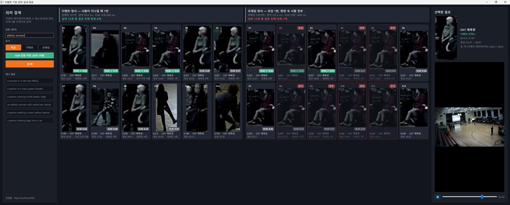

# event-semantic-indexer

**카메라 메타데이터가 알려주는 "사람이 지나간 순간"에만 임베딩하는 자연어 영상 검색 인덱서 (C++)**

자연어 영상 검색(예: "흰 비닐봉지를 든 사람")은 보통 일정 간격으로 프레임을 뽑아 화면 속 사람을 전부 임베딩합니다. 그러면 비용이 **채널 수 × 시간**에 비례하고, 오래 머문 한 사람이 인덱스를 도배합니다.

이 프로젝트는 AI 카메라가 보내는 객체 메타데이터(ONVIF / WiseAI 형식)를 트리거로 씁니다. 사람이 화면을 떠날 때 오는 **요약 프레임의 베스트샷 1장**만 임베딩해서, 비용을 **지나간 사람 수**에 비례하게 바꿉니다. 붐비는 현장에서 추적 ID가 끊겨 한 사람이 여러 조각으로 나뉘는 문제는 **트랙 조각 잇기**로 풉니다.


*"elderly woman" 검색 — 왼쪽(이벤트 방식, 임베딩 197개)은 4위부터 흰머리 노인을 찾고, 오른쪽(프레임 방식, 5,879개)은 오래 앉아 있던 한 사람이 상위 12개를 전부 차지한다.*

## 결과 (MEVA 공개 데이터, 카메라 3대 × 5분 — 사람이 있는 현장은 체육관·실외 2곳, 질문 30개 직접 라벨링)

| 방식 | 임베딩 | recall@1 | recall@5 | recall@10 | recall@50 |
|---|---|---|---|---|---|
| 프레임 (초당 1번, 화면 속 사람 전부) | 5,879 | 0.30 | 0.47 | 0.50 | 0.67 |
| 이벤트 (요약 프레임 베스트샷) | 253 | 0.33 | 0.50 | 0.57 | 0.90 |
| **이벤트 + 트랙 조각 잇기** | **197 (1/30)** | **0.33** | **0.57** | **0.70** | **0.90** |

**같은 CPU로 감당하는 채널** — 부하 시뮬레이션: 가장 붐비는 체육관 카메라에서 실측한 임베딩 발생 시각을 N채널로 복제(채널마다 랜덤 시작점)해 실시간으로 재생하고, 임베딩은 실제로 실행. 관제 영상 30fps 디코딩을 같은 PC에서 동시에 돌림. (데스크톱 6코어/12스레드, `eval/control_bench.py`)

| 조건 | 필요 임베딩/초 | 검색 반영 지연 p50 / p95 | 관제 영상 |
|---|---|---|---|
| 이벤트 64채널 | 39.5 | 0.8초 / 3.6초 | 30fps 유지 |
| 프레임 2채널 | 38.3 | 0.6초 / 1.3초 | 30fps 유지 |
| 프레임 4채널 | 76.5 | 16초 / 31초, 계속 증가 | 30fps 유지 |

→ 이벤트 방식 64채널의 부하가 프레임 방식 2채널과 같다. 카메라 64대를 실제로 연결한 것이 아니라, 64대 전부가 체육관만큼 붐비는 최악의 경우를 재현한 것이다.

### VLM 선택 검증 — 검색 서버가 상위 10명만 VLM에 묻는다
`/search?...&verify=10`이면 검색 서버(C++)가 임베딩 상위 10명의 사진을 VLM 서비스(Qwen2-VL-2B, FP16)에 보내 "이 사진이 질문에 맞나? yes/no"의 P(yes)를 받고, 그 순서로 다시 줄 세운다. VLM 서비스가 멈춰 있으면 임베딩 결과를 그대로 돌려준다. 질문 30개, 두 방식 같은 조건, 서버 경로로 측정(`eval/e2e_eval.py`).


*VLM 검증을 켜고 "elderly woman" 검색 — 이벤트 쪽은 임베딩 10위였던 흰머리 노인이 VLM ✓ 0.96으로 1위가 된다. 프레임 쪽은 후보 12명이 전부 같은 사람이라 VLM을 켜도 바뀌지 않는다.*

| 인덱스 | 방식 | recall@1 | recall@5 | recall@10 | VLM 호출/질문 |
|---|---|---|---|---|---|
| 프레임 | 임베딩만 → VLM 상위 10명 | 0.30 → 0.40 | 0.47 → 0.50 | 0.50 → 0.50 | 10 |
| **이벤트** | **임베딩만 → VLM 상위 10명** | **0.33 → 0.60** | **0.57 → 0.70** | 0.70 → 0.70 | 10 |
| **이벤트** | VLM 상위 20명 | **0.63** | **0.80** | **0.80** | 20 |

질문 1개 응답 시간(p50): 이벤트 VLM 10명 0.8초 / 20명 1.6초, 프레임 VLM 10명 1.0초(프레임 결과는 사진을 영상에서 그때그때 잘라야 해서 더 느림).

같은 VLM 예산인데 효과가 다른 이유: 프레임 방식 상위 10명은 같은 사람의 반복이라 VLM이 고를 후보가 없다. **싸고 다양한 1단계가 비싼 VLM을 효과 있게 만든다.**

**애매할 때만 VLM을 더 부르기** (`verify=10&step=3&stop=0.7`): 임베딩 순서대로 3명씩 VLM에 보내다가, 지금까지 최고 P(yes)가 0.7 이상이면 멈춘다. 규칙은 질문 30개의 상위 20명 VLM 점수를 한 번 받아 둔 뒤 여러 규칙을 비교해서 골랐다(`eval/adaptive_sim.py`). 기준값을 0.6~0.8, 묶음을 3~5명으로 바꿔도 @1이 같게 나왔다.

| 검증 규칙 | VLM 호출/질문 | recall@1 | recall@10 | 응답 p50 |
|---|---|---|---|---|
| 고정 10명 | 10 | 0.60 | 0.70 | 0.83초 |
| **3명씩, 0.7에서 멈춤, 최대 10명** | **6.1** | **0.63** | 0.70 | **0.53초** |
| 3명씩, 0.7에서 멈춤, 최대 20명 | 9.4 | 0.67 | 0.77 | 0.53초 |

임베딩 점수로 "확실한지" 판단해 VLM을 건너뛰는 규칙은 버렸다: 1·2위 점수 차가 중간값 0.005라 구분이 안 됐고, 건너뛰면 @1이 0.50까지 떨어졌다. 멈출지 말지는 VLM의 답으로 정한다.

**같은 GPU에 인덱서 + VLM** (RTX 3070 8GB, 별도 프로세스, 64채널 인덱싱 부하를 걸고 VLM 질문 1개 = 베스트샷 10장 검증 반복)

| 조건 | 인덱싱 처리율 | VLM 질문 1개 (p50) |
|---|---|---|
| 부하 없음 | — | 0.68초 |
| **이벤트 64ch** (0.5초 마이크로배치) | 99% | **0.70초 (1.0배)** |
| 프레임 64ch, 초당 1번 | 100% | 1.41초 (2.1배) |
| 프레임 64ch, 초당 5번 | 36% (계속 쌓임) | 1.57초 (2.3배) |

메모리: VLM 4.17GB + CLIP 0.56GB. 측정 스크립트: `eval/e2e_eval.py`(서버 경로), `eval/vlm_rerank.py`(초기 실험, 같은 숫자), `eval/gpu_share_bench.py`, `eval/gpu_clip_bench.py`

## 구조

```
AI 카메라 (WiseAI 메타데이터)            ← 실험에서는 camsim/ 대역 카메라가 같은 형식으로 생성
  ├ 객체 프레임 5Hz: ObjectId, BoundingBox
  └ 퇴장 시 요약 프레임: 베스트샷, 옷 색상
        │
        ▼
[indexer]  C++
  MetadataParser → Stitcher(트랙 조각 잇기, 지연 확정) → 필터(보인 시간·크기)
  → ImageEmbedder(CLIP ViT-B/32, ONNX Runtime) → hnswlib
        │  index.bin / items.jsonl
        ▼
[search_server]  C++
  ClipTokenizer(BPE, open_clip과 토큰 일치 검증) → TextEmbedder → hnswlib top-k
  → (verify=N) 상위 후보 사진을 3명씩 ──HTTP──▶ [vlm_service] Qwen2-VL yes/no
      확실한 yes(≥0.7)가 나오면 멈춤, 아니면 다음 3명 (최대 N) → 다시 줄 세움
  → HTTP: /search, /img, /info
        │
        ▼
[demo]  Qt Quick (QML) — 이벤트 / 프레임 결과 나란히 비교, 원본 영상 재생

```

### 트랙 조각 잇기
사라진 객체의 위치를 속도로 외삽해서, 짧은 시간 안에 가까운 곳에 새로 뜬 ID를 같은 사람으로 묶습니다. 묶은 그룹은 이어질 조각이 더 없을 때까지 기다렸다가(지연 확정) 가장 큰 베스트샷 1장으로 한 번만 임베딩합니다.
기준(거리 3%, 1초)은 강제 끊김 실험(정답을 아는 끊김 680쌍)에서 정했습니다. 정밀도 0.87(자동 채점 하한, 표본 눈 확인 시 약 0.95), 재현율 0.98입니다. 요양원 프로젝트(고정 앵커가 있음)의 18%·5초 기준은 붐비는 현장에서 다른 사람을 잇는 오류가 많아 버렸습니다.

### 해보고 버린 것
- **옷 색상 / 색 히스토그램으로 잇기 검증:** 어두운 체육관에선 대부분 '검정'이라 변별력이 없고, 밝은 곳 ↔ 그늘을 오가면 같은 사람도 히스토그램이 크게 달라져서 득보다 실이었습니다. 학습된 ReID 특징(카메라가 메타데이터로 보내는 특징 벡터)으로 검증하는 것이 맞는 방향입니다.

## 폴더

| 폴더 | 내용 |
|---|---|
| `indexer/` | C++ 인덱서(`indexer`) + 검색 서버(`search_server`) |
| `demo/` | Qt Quick 검색 데모 클라이언트 |
| `camsim/` | 대역 카메라: 영상 → YOLO + ByteTrack → WiseAI 형식 메타데이터·베스트샷 |
| `vlm/` | VLM 검증 서비스 (검색 서버가 HTTP로 호출) |
| `model/` | CLIP → ONNX 변환(`export_clip.py`), 파이썬 검색 확인 도구 |
| `eval/` | 비교군(프레임 인덱스), 평가(recall@k), 잇기 정확도, 채널 용량, 관제 영향 측정, 질문 30개 |

## 실행

**준비** (WSL2 Ubuntu 24.04 기준)
```bash
sudo apt install build-essential cmake libopencv-dev python3-dev
pip install torch open_clip_torch onnx onnxscript onnxruntime hnswlib ultralytics opencv-python
git clone https://github.com/nmslib/hnswlib ~/hnswlib
# ONNX Runtime 1.20.1: NuGet Microsoft.ML.OnnxRuntime 패키지의 build/native/include, runtimes/linux-x64/native → onnxruntime/include, onnxruntime/lib
cd model && python export_clip.py && gunzip -k bpe_simple_vocab_16e6.txt.gz
```

**빌드**
```bash
cmake -S indexer -B ~/build/indexer -DHNSW_DIR=$HOME/hnswlib && cmake --build ~/build/indexer -j
```

**메타데이터 생성 → 인덱싱 → 검색**
```bash
python camsim/fake_wiseai_cam.py <영상> --ch 0 --out camsim/out_raw     # 채널마다
~/build/indexer/indexer --meta camsim/out_raw --model model/clip_image.onnx --out ~/idx_event \
    --min-dur 0.5 --stitch 1 --link-dist 0.03 --link-sec 1
~/build/indexer/search_server --event ~/idx_event --frame ~/idx_frame --frags camsim/out_raw \
    --videos <영상 폴더> --text model/clip_text.onnx --vocab model/bpe_simple_vocab_16e6.txt \
    --vlm http://localhost:8766          # VLM 검증을 쓸 때만
python vlm/vlm_service.py --port 8766    # VLM 검증 서비스 (GPU, 약 4.2GB)
```
데모는 `demo/CMakeLists.txt`를 Qt Creator(Qt 6.5+, Quick·Multimedia)로 열어 실행합니다. 기본 서버 주소는 `http://localhost:8765`입니다.

## 한계
- 현장 2곳(체육관, 실외), 5분. 채널 용량은 실측 부하 패턴을 복제한 시뮬레이션. 정답은 직접 라벨링했습니다(질문 묘사에 맞는가 기준).
- 실제 카메라 대신 대역 카메라를 썼습니다. 메타데이터 형식은 실제 카메라 캡처를 기준으로 맞췄고, 요약 프레임의 옷 색상 태그 형식은 가정입니다.
- 오래 끊겼다가 다시 나타난 같은 사람은 별개로 남습니다(ReID 벡터로 합칠 대상).

## 데이터·라이선스
- 영상: [MEVA](https://mevadata.org) (CC BY 4.0). 저장소에는 포함하지 않았습니다.
- 모델: open_clip ViT-B-32 (laion2b_s34b_b79k).
